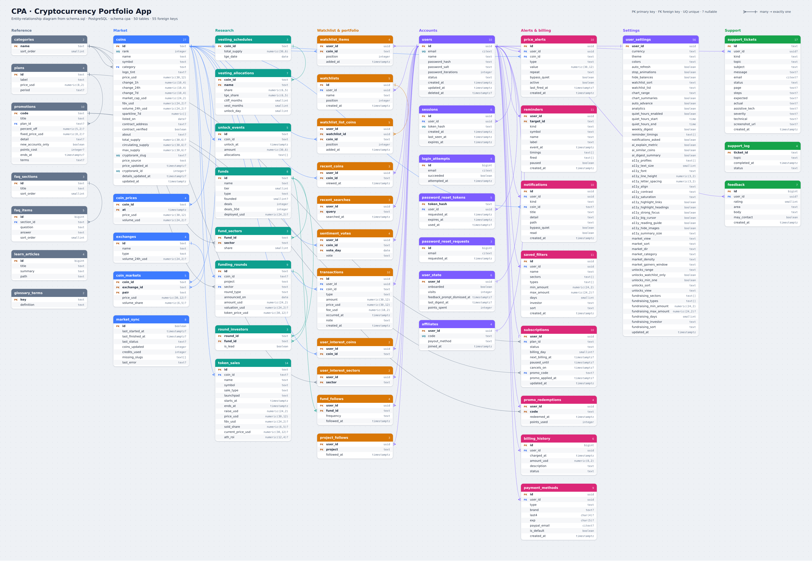

# CPA: Cryptocurrency Portfolio App

CPA is a responsive single-page app for following the crypto market: coin rankings, token unlocks, funding rounds, token sales, a watchlist, a manual portfolio and alerts. It's a build of the CryptoRank-style product described in `app_outline/`. Prices for 34 major coins come live from CryptoRank through a scheduled Supabase Edge Function; everything else is bundled sample data. Accounts use Supabase (Auth plus Postgres in the `cpa` schema).

It adapts to phones, tablets, notebooks and desktops: a bottom nav on phones, full-width pages on tablets and a sidebar from 1024px wide (`app/src/styles/responsive.css`). It is hosted on Vercel at https://cpa-black.vercel.app/

> Not financial advice. Data provided for informational purposes. Live prices come from CryptoRank; unlocks, rounds and the remaining coins are sample data.

## Quick start

```bash
nvm use           # Node 26.12.1 from .nvmrc (Vercel builds on Node 24.x)
cp .env.example .env   # then fill in the Supabase values (Dashboard → Project Settings → API)
cd app
npm install
npm run dev        # http://localhost:5173
npm run lint       # oxlint
npm run build      # production build in app/dist
```

To try it without an account, open **Log in** and choose **Try a private demo**. The demo has a populated watchlist, portfolio, alerts and notifications, and resets when you refresh.

## Hosting

CPA is live at **https://cpa-black.vercel.app** (Vercel project `cpa`, root directory `app/`).

- **Deploy:** the Vercel project is connected to this GitHub repo with root directory `app`. A push to `main` (merging a PR) deploys production; every other branch and PR gets a preview deployment and a "Vercel" check. `app/vercel.json` builds with Vite, sends every route to `index.html` (BrowserRouter), serves `sw.js` with `no-cache` so updates reach installed apps, caches the hashed `/assets/*` for a year, and sets `nosniff`, `X-Frame-Options: DENY`, a referrer policy and a permissions policy.
- **Build variables:** only `VITE_SUPABASE_URL` and `VITE_SUPABASE_PUBLISHABLE_KEY`, set in the Vercel project for production and preview. Server keys are never added to Vercel.
- **Supabase settings for the hosted origin:**
  - CORS: the Edge Functions' `ALLOWED_ORIGINS` is `http://localhost:5173,http://localhost:4173,https://cpa-black.vercel.app` (dev server, `vite preview`, hosted site; set Oct 25, 2026). Setting it replaces the whole list, so include every origin. The Supabase REST and Auth APIs allow any origin and are protected by RLS and the session instead.
  - Auth → URL Configuration → Redirect URLs needs `https://cpa-black.vercel.app/**` for password-reset links (set in the Dashboard).

## Who it's for

The personas come from `app_outline/user_journey.md`:


| Persona                       | Wants                                                   | CPA answers with                                                                                                           |
| ------------------------------- | --------------------------------------------------------- | ---------------------------------------------------------------------------------------------------------------------------- |
| **Maya**, active trader       | Spot movers early, react to unlocks before price impact | Gainers/losers, unlock calendar sorted by % of supply, one-tap**Remind me**, price alerts                                  |
| **Daniel**, research investor | Tokenomics, vesting, who funded a project               | Coin detail tabs (Overview, Tokenomics, Funding, Markets), supply bar, vesting chart, portfolio with entry vs. round price |
| **Priya**, VC / fund analyst  | Monitor rounds and competitor deals                     | Fundraising feed with saved filters, fund profiles, follow a fund, share cards                                             |
| **Leo**, newcomer             | Understand the numbers, follow a few coins safely       | Onboarding with interest picker, Simple view, ⓘ explanations on every metric, Learn cards                                 |

## What's in the app


| Area                | Pages                                                                                                                 |
| --------------------- | ----------------------------------------------------------------------------------------------------------------------- |
| Bottom nav (7 tabs) | Home, Market, Explore, Fundraising, Unlocks, Watchlist, Portfolio                                                     |
| Research            | Coin detail, Search (and the ⌘K overlay), Fund profile, Token sales                                                  |
| Account             | Alerts, Log in / Sign up, Forgot / Reset password, Log out, Account settings                                          |
| Help and info       | Customer support, FAQs, Report an issue, Feedback, Promotions, Affiliate program, Technical requirements, AI features |
| Legal               | Terms of service, Privacy policy, Accessibility policy (linked in every footer)                                       |
| Everywhere          | Accessibility menu (♿ button or Alt+A), keyboard shortcuts (?), Not found page with "Did you mean"                   |

Each page has a spec with its wireframe, stories and "done when" conditions in `app_outline/pages/` (`00-app-shell.md` to `29-not-found.md`).

## What the outline asks for

`app_outline/` holds the source documents. `prompt.md` condenses what they require, and `CLAUDE.md` turns that into working rules.

- **`user_stories.md`:** 9 epics of stories (US-1.1 to US-9.6), each with Given/When/Then criteria. The 22 P0 stories (81 points) are the MVP; P1 and P2 stories are built where a browser allows.
- **`user_journey.md`:**

  - The four personas and their journey maps.
  - Three core flows: first launch, set an unlock reminder, research a project.
  - The six cross-journey rules: ask for notifications only at the first alert, remember choices per tab, show events on charts, show trust signals, offer Simple vs Pro, and allow full guest browsing.
  - The "moments that matter", each with how it's measured:


    | Moment                    | Measured by                                              |
    | --------------------------- | ---------------------------------------------------------- |
    | First data on screen      | 2 s or less from a cold start                            |
    | First watchlist add       | share of new users who add a coin in their first session |
    | First alert fires on time | delivered within 30 s of the trigger                     |
    | A shared card gets opened | shares that turn into new users                          |
    | Day-7 return              | 7-day retention                                          |
- **`style_guide.md`:** principles, voice, colour, type, spacing, components, states, motion and accessibility. The **Design** and **Accessibility** sections below summarise it.

## How data is kept


| Who          | Where                                                                              | Survives a refresh?   |
| -------------- | ------------------------------------------------------------------------------------ | ----------------------- |
| Guest        | Memory only                                                                        | No                    |
| Private demo | Memory only                                                                        | No, resets on refresh |
| Account      | Supabase: Auth for sign-in, Postgres tables in the`cpa` schema for everything else | Yes, on any device    |

Accounts run on Supabase:

- **Sign-in:** Supabase Auth handles passwords, sessions, reset emails and rate limits. The app still requires 13+ characters with a lowercase letter, an uppercase letter, a digit and a symbol, and refuses known leaked passwords. The browser keeps only the Auth session (`cpa:v1:auth`).
- **Data:** `app/src/lib/cloud.js` maps the app's data to the `cpa` tables and saves only what changed, about 0.6 s after each change. Row-level security limits every request to the signed-in user's own rows.
- **Billing:** simulated, test cards only. It's stored in `user_state.simulated_billing`; the real `subscriptions` table stays server-only.
- **Deleting:** Delete account marks the profile deleted. Logging in to a deleted account offers **Remove my data**, which erases it for good (`cpa.erase_my_data()`).

The schema, migrations, the sample-data seed and the live price Edge Function are in `supabase/` (see below).

## Languages

CPA is in English and Spanish. Guests start in the browser's language and can switch in the menu; signed-in users can also choose in Settings › Preferences, which saves it to their account. `lib/i18n.js` looks up each English string in `src/locales/es/` (one file per area) and falls back to English; numbers and dates follow the language. Run `npm run i18n:check` in `app/` to list strings without a Spanish entry.

## Design

The design follows `app_outline/style_guide.md`, with the Figma wireframe (`app_outline/figma-wireframe/`) taking precedence where they differ.

- **Principles:** data first, glanceable, trustworthy, dense but calm, thumb-friendly.
- **Theme:** dark by default, with light and system options. The accent is violet, from the wireframe, rather than the guide's blue.
- **Type:** Inter with tabular figures for every number; JetBrains Mono for contract addresses.
- **Numbers:**
  - Abbreviated large values (`$1.24B`).
  - Signed percentages to 2 decimals with a true minus (`−0.48%`).
  - Direction is never shown by colour alone: values carry ▲ ▼ or + −.
- **Colour options:** up/down colours can be swapped, or switched to a colour-blind safe blue/orange pair.
- **Voice:** a neutral research analyst. Market data is factual, empty states are friendly and brief, errors are plain and say what to do next, and alerts sound urgent only when something is time-sensitive. Never advice or hype.
- **States:**
  - Loading: skeleton shimmer.
  - Empty: one sentence and one action.
  - Error: inline banner with Retry.
  - Stale: data over 5 minutes old is marked with "Last updated".
- **Motion:**
  - Durations: 150 ms micro, 250 ms screens, 350 ms sheets.
  - Prices flash for 400 ms when they change.
  - The system Reduce Motion setting and the in-app "Stop animations" switch both turn all of this off.

## Accessibility

The target is WCAG 2.2 AA:

- **Contrast:** text meets 4.5:1 in both themes.
- **Touch targets:** at least 44×44 px.
- **Focus:** focus is visible and never hidden under the sticky bars.
- **Navigation:** a skip link, and route changes are announced to screen readers.
- **Charts:** each chart has a text summary.
- **Text size:** up to 200%; tables become stacked cards above 130%.
- **Accessibility menu:** profiles plus settings for text, fonts, spacing, contrast, saturation, link and heading highlights, a reading guide, a big cursor, hiding images and stopping animations.

To simulate an error banner on Home, Market, Explore, Fundraising or Watchlist, add `?simulate=error` to the address. To see an unlock reminder reschedule (US-4.2), open any page with `?simulate=reschedule` and start the demo: its ARB reminder is stored 2 days early, so the next check moves it to the real date and shows "ARB unlock moved to …".

## CryptoRank lookup script

`lookup.py` is a separate command-line tool that looks up live CryptoRank ranks and prices for ticker symbols you type in.

```bash
cp .env.example .env     # then add SUPABASE_URL and SUPABASE_PUBLISHABLE_KEY
python3 lookup.py
```

- **Key:** the CryptoRank key stays in Supabase as the `CRYPTORANK_API_KEY` Edge Function secret. Supabase never returns a secret's value, so `lookup.py` doesn't read it: it sends the symbols to the `cryptorank-lookup` Edge Function, which looks them up with the key. The script needs only the project URL and publishable key, which are public.
- **Limits:** up to 5 symbols per request (the script batches longer lists) and at most 6 CryptoRank requests per call, so it stays under the free plan's 10 a minute alongside the price sync. Lookups share a budget of 60 credits a day (`cpa.spend_lookup_credit()`, counted in the server-only `cpa.cryptorank_lookup_usage`); with the sync's ~305 that stays under 400. Over the budget the script says so; it resets at 00:00 UTC.
- **Cost:** a ticker in the top 300 costs 1 to 3 credits; others cost up to 7 (the symbol map plus up to 3 same-ticker coins).
- **Endpoint:** POST only, no browser origins (403), 1 KB body cap, tickers of 1 to 15 letters or digits, generic errors.
- **Deploy:** `supabase functions deploy cryptorank-lookup --project-ref <ref> --no-verify-jwt --use-api`, after `deno check` and `deno lint`. The script sends the publishable key, which isn't a JWT, so the gateway's JWT check is off.

## Supabase

```bash
cd supabase
npm install
npm run seed       # loads app/src/data/*.js into the cpa reference tables (safe to re-run; keeps live CryptoRank prices)
```

- `migrations/`: the `cpa` schema, RLS policies, the account functions, the live price and price history syncs (columns, `market_sync`, `price_history_sync`, RPCs, pg_cron schedules, comments), named watchlists, guest-input limits, the server-only rate limits, and table comments. All 17 are applied to the linked project.
- `functions/cryptorank-sync/`: the Edge Function that writes live CryptoRank prices into `cpa.coins` (see [Live prices](#live-prices)). It's deployed to the linked project.
- `functions/cryptorank-lookup/`: the Edge Function `lookup.py` calls, so the CryptoRank key stays a function secret (see [CryptoRank lookup script](#cryptorank-lookup-script)).
- `functions/wallet-lookup/`: the Edge Function that reads a public Bitcoin or Ethereum address's balances and transfer history for wallet import (see [Wallet import](#wallet-import)).
- **Advisors** (reviewed Oct 25, 2026, Supabase CLI 2.122): the remaining notices are intended.
  - "RLS enabled, no policy" on the four server-only tables (`market_sync`, `support_log`, `wallet_lookup_quota`, `cryptorank_lookup_usage`).
  - SECURITY DEFINER warnings on `delete_my_account()` and `erase_my_data()` (they must reach Auth and every user table, and act only on the caller) and on `coin_sentiment_today()` (public vote totals, no voter data).
  - 33 "unused index" notices: 23 cover foreign keys, which every FK keeps (data model rules), and 10 back the server-side search, sort and due-date queries `schema.sql` is designed for (trigram name search, market-cap order, upcoming sales and rounds, due reminders). The app reads sample data locally for now, so they're idle; on tables this small they cost almost nothing. Keep them.
- `seed/seed-sample-data.mjs`: uses `SUPABASE_SECRET_KEY` from `.env`. That key is server-only: never give it a `VITE_` prefix.
- The app reads `VITE_SUPABASE_URL` and `VITE_SUPABASE_PUBLISHABLE_KEY` from the root `.env` (`envDir: '..'` in `vite.config.js`).
- Auth settings to check in the Dashboard: turn off **Confirm email**, so sign-up logs straight in; set a 13-character minimum and require lowercase, uppercase, digits and symbols under **Authentication → Password policy**; add `http://localhost:5173/reset-password`, `http://127.0.0.1:5173/reset-password`, and your deployed URL under **Authentication → URL configuration → Redirect URLs**.

## Data model



`schema.sql` is the full PostgreSQL model of every feature and setting in the app: 53 tables, 55 foreign keys and 3 views, all in the `cpa` schema. `drawsql.png` is its diagram; regenerate it with `npm run diagram` in `tools/diagram/`. Comments on each table and column cite the page spec or story they come from. The tables fall into the same groups as the diagram:


| Group                 | Tables                                                                                                                                                                                                                                  | Holds                                                                                                             |
| ----------------------- | ----------------------------------------------------------------------------------------------------------------------------------------------------------------------------------------------------------------------------------------- | ------------------------------------------------------------------------------------------------------------------- |
| Reference             | `categories`, `plans`, `promotions`, `faq_sections`, `faq_items`, `learn_articles`, `glossary_terms`                                                                                                                                    | Fixed lists and help content                                                                                      |
| Market | `coins`, `coin_prices`, `exchanges`, `coin_markets`, `market_sync`, `price_history_sync`, `cryptorank_lookup_usage` | Rankings, Coinbase price history, where each coin trades, the last live price and price history syncs, CryptoRank credits spent by `lookup.py` |
| Research              | `vesting_schedules`, `vesting_allocations`, `unlock_events`, `funds`, `fund_sectors`, `funding_rounds`, `round_investors`, `token_sales`                                                                                                | Tokenomics, unlocks, fundraising, token sales                                                                     |
| Watchlist & portfolio | `watchlist_items`, `watchlists`, `watchlist_list_coins`, `recent_coins`, `recent_searches`, `sentiment_votes`, `transactions`, `wallet_lookup_quota`, `user_interest_coins`, `user_interest_sectors`, `fund_follows`, `project_follows` | What each user tracks, holds and follows                                                                          |
| Accounts              | `users`, `sessions`, `login_attempts`, `password_reset_tokens`, `password_reset_requests`, `user_state`, `affiliates`                                                                                                                   | Sign-in, counters and flags, affiliate codes                                                                      |
| Alerts & billing      | `price_alerts`, `reminders`, `notifications`, `saved_filters`, `subscriptions`, `promo_redemptions`, `billing_history`, `payment_methods`                                                                                               | Alerts and their inbox, saved Fundraising filters, plans and payments                                             |
| Settings              | `user_settings`                                                                                                                                                                                                                         | One row per user: display, notifications, AI features, the accessibility menu and each tab's remembered filters   |
| Support               | `support_tickets`, `support_log`, `feedback`                                                                                                                                                                                            | Tickets, issue reports, data-removal log, feedback                                                                |

Views: `coin_sentiment`, `portfolio_holdings` (net amount and average buy price) and `user_points` (loyalty points).

The live database runs the Supabase version in `supabase/migrations/`. It differs from `schema.sql` in these ways:

- **Accounts:** Supabase Auth replaces the password columns and the `sessions`, `login_attempts` and `password_reset_*` tables, so it has 48 tables. `cpa.users` is a profile row keyed to `auth.users`.
- **Access:** row-level security is on every table.
- **Sentiment:** `coin_sentiment` became the `coin_sentiment_today()` function, which returns totals without revealing who voted.
- **Later migrations:** `cpa_app_accounts` added `user_state.simulated_billing` and the account functions `delete_my_account()` and `erase_my_data()`. `cryptorank_live_prices` added the live price columns on `coins`, the `market_sync` table and the pg_cron schedule, and `market_sync_comments` copied `schema.sql`'s descriptions of them into the database. `cryptorank_more_live_data` added `coins.cryptorank_id` and `details_updated_at`, made `rank` uniqueness deferrable so adding a coin can re-rank the rest, and mapped Toncoin and Maker; `map_zcash` mapped Zcash. `review_feedback_fixes` (from PR #6) requires an active profile for every account-data rule, so a deleted account can't read or change its data before it's erased; makes `erase_my_data()` delete the account's tickets and feedback; applies the 10 saved-filter limit to new filters only; and stops issue IDs truncating past 9999. `named_watchlists` added `watchlists`, `watchlist_list_coins` and `user_settings.watchlist_list` (US-6.2), and `named_watchlists_upsert_limit` applies the 10-list limit to new lists only. `harden_guest_input` bounds what guests can write (see [Live prices](#live-prices), "Guest input"). `wallet_lookup_quota` adds the server-only rate limit and `claim_wallet_lookup()` for wallet import (see [Wallet import](#wallet-import)). `cryptorank_lookup_usage` adds the daily credit budget for `lookup.py` (see [CryptoRank lookup script](#cryptorank-lookup-script)). `transactions_comments` copies `schema.sql`'s description of `transactions`, including how wallet-import rows are dated, priced and matched (see [Wallet import](#wallet-import)), into the database. `price_history` adds `coins.history_updated_at`, the server-only `price_history_sync` table, the sync's RPCs and pg_cron schedule, and the public `price_history()` range reader (see [Live prices](#live-prices), "Price history"). `price_at` adds the public `price_at(coin_id, at_ms)`, the nearest stored close to a moment, for the transaction sheet's "Use market price". `price_history_comments` copies `schema.sql`'s descriptions of `coin_prices`, `price_history_sync` and the five price history functions into the database.

`schema.sql` stays the portable reference for running CPA on any PostgreSQL 15+ server.

### Live prices

- **Sync:** `supabase/functions/cryptorank-sync` fetches the top 200 coins from CryptoRank v3 and writes price, 24h change, market cap and volume into `cpa.coins` for the 33 ranked coins mapped by `cryptorank_slug`. pg_cron calls it every 10 minutes (2 credits a run). This refresh rate is accepted for the free plan; the stale marker shows when prices are over 5 minutes old.
- **Details:** each run also fetches CryptoRank's per-coin endpoint for up to 6 coins whose 7d change and FDV are over 48 hours old (1 credit each, 8 requests a run at most, under the 10-a-minute limit). That refreshes 7d change and FDV for every mapped coin about every 2 days, plus Maker's price, which isn't in the top 200. In all about 305 credits a day, inside the free plan's 400 a day and 10K a month.
- **Coins:** Zcash (ZEC) was added on Oct 18, 2026. Toncoin is listed on CryptoRank as Gram (GRAM), the layer 1 first developed by Telegram, so its live figures come from that entry.
- **Key:** `CRYPTORANK_API_KEY` is an Edge Function secret, set from `.env` with `supabase secrets set --env-file <(grep '^CRYPTORANK_API_KEY=' .env)`. It never reaches the browser.
- **Abuse limit:** the function is public (pg_cron calls it without a JWT), so `cpa.claim_market_sync()` lets a run start at most once every 9 minutes. It reads nothing from the request, refuses bodies over 1 KB (413), and returns only counts and generic error text; the details go to the function logs and `cpa.market_sync`.
- **CORS:** browsers may call it only from the origins in the `ALLOWED_ORIGINS` function setting (comma-separated; default `http://localhost:5173`; see [Hosting](#hosting) for the current list). Other origins get 403, and preflight `OPTIONS` returns 204. pg_cron sends no `Origin` header and isn't affected. The app itself never calls the function: it reads `cpa.coins` over REST.
- **App:** `app/src/lib/market.js` reads those rows over the REST API on load and every 30 s. If a request fails, the last data stays on screen with the error banner and Retry. Before the first sync, or without Supabase, the simulated feed stands in. Coins without Coinbase history keep sample 1h change and sparklines, and Coin detail names the source of each figure.
- **Price history:** `supabase/functions/price-history-sync` reads Coinbase Exchange's public candles (no key) for the 31 live coins Coinbase lists and writes their closes into `cpa.coin_prices`: 15-minute closes for 26 hours, hourly for 8 days, 6-hourly for 32 days and daily for the whole history, which it backfills one 300-day page a coin per run. It also writes `change_1h`, the 24-point `sparkline_7d` and `history_updated_at` into `cpa.coins`. pg_cron calls it at :07, :22, :37 and :52; `cpa.claim_price_history_sync()` lets a run start at most every 10 minutes. A product whose price is more than 10% from CryptoRank's is skipped as a different asset. TRON and USDC have no Coinbase USD market and Maker's was delisted, so they keep sample charts. The app reads one range at a time with the public `cpa.price_history(coin_id, range_id)` (`app/src/lib/history.js`): 1D 15-minute, 7D hourly, 1M 6-hourly, 3M, 1Y and ALL daily, plus the highest and lowest daily close for all-time high and low. The 7d change of those coins is read from the same closes, so it always matches the chart and sparkline. Health: `select * from cpa.price_history_sync;`. Deploy like `cryptorank-sync`.
- **Deploy:** `supabase functions deploy cryptorank-sync --project-ref <ref> --no-verify-jwt --use-api`. Run `deno check` and `deno lint` on the function first.
- **Health:** `select * from cpa.market_sync;` shows the last run: status, coins updated, credits used, any slugs CryptoRank didn't return, and the last error.
- **Test:** a POST to `/functions/v1/cryptorank-sync` returns `{"status":"ok","updated":31,...}`, or `skipped` within 9 minutes of the last run. A GET returns 405.
- **Guest input:** guests can only insert support tickets, issue reports and feedback. `harden_guest_input` caps every free-text field at its form's limit, accepts screenshots only as PNG or JPEG data URLs under 2 MB, lets callers set only the fields the forms send (not `status` or `created_at`), and rejects ticket IDs that `next_ticket_id()` hasn't issued.

### Wallet import

- **What:** Portfolio → Import from wallet (read-only) takes a public Bitcoin or Ethereum address (US-6.4). Bitcoin balances come from mempool.space (no key). ETH and the ERC-20 tokens CPA lists come from Etherscan. The app never asks for a recovery phrase, private key or exchange key, and refuses input that looks like one before anything is sent.
- **Where it runs:** the browser calls `supabase/functions/wallet-lookup`, never the explorers, so `ETHERSCAN_API_KEY` stays a function setting: `supabase secrets set --env-file <(grep '^ETHERSCAN_API_KEY=' .env)`. A free key comes from etherscan.io → API keys.
- **Who can call it:** a signed-in user only; the function checks the Supabase session itself. Only `ALLOWED_ORIGINS` get CORS headers, the body is capped at 1 KB, the address must match the Bitcoin (base58 or bech32) or Ethereum (`0x` + 40 hex) format, and errors are generic.
- **Rate limit:** 10 lookups an hour per user and 30 per IP, counted by `cpa.claim_wallet_lookup()` in the server-only `cpa.wallet_lookup_quota` (IPs stored only as SHA-256 hashes). Over the limit returns 429. Addresses are never stored on the server.
- **Cost basis:** the function also reads the address's transfers and returns the net change per coin per UTC day, priced at that day's close from Coinbase Exchange's public candles (no key; at most 12 price requests a lookup). Bitcoin reads the newest 200 confirmed transactions (fees included); Ethereum reads the newest 1,000 normal (gas included), internal and token transfers. At most 300 coin-days are returned; when older history wasn't read, `complete` is false.
- **Import:** a preview lists each coin. A first import records each day's transfer, dated that day at that day's close; when history is partial, the balance before it is an opening transfer in at the earliest day read. A re-import adds only later days. Anything the history doesn't explain (staking payouts, unlisted contracts) is an adjustment at today's price, so holdings always match the wallet. Rows carry the short address in the note, so re-importing doesn't double-count, and "Rebuild from history" replaces an address's earlier rows (e.g. ones made at today's price before history was read).
- **Deploy:** `supabase functions deploy wallet-lookup --project-ref <ref> --no-verify-jwt --use-api`, after `deno check` and `deno lint`.

### Portfolio tools

- **Performance (clarification 28):** the value chart prices each held coin from Coinbase closes (`usePriceHistories` in `app/src/lib/history.js`) and falls back to sample history per coin, naming those coins under the chart. The summary splits all-time P&L into unrealized and realized (average cost), and "P&L over 1M" is the change in value less money put in (buys and transfers in, with fees) plus money taken out (sell proceeds and transfers out). "Use market price" fills the nearest close from `cpa.price_at`.
- **Tax-lot report:** Portfolio → Tax-lot report matches each sell to the lots it came from, by FIFO (short-term a year or less, long-term over a year) or average cost, filtered by year sold, and downloads `cpa-tax-lots-<method>-<year>-<date>.csv` (USD). It's computed in the browser from the transactions (`app/src/lib/taxlots.js`) and never stored. Buy fees add to cost, sell fees reduce proceeds, and transfers out remove lots without a gain. It says it isn't tax advice.
- **Exchange CSV import (clarification 29):** Portfolio → Transactions as CSV → Import also reads Coinbase transaction history, Kraken trades and Binance spot trade history (`app/src/lib/exchanges.js`), recognised by their headers and read on the device. Coinbase converts become a sell and a buy; rewards and staking income become transfers in at that day's price. Prices must be USD; USD stablecoins (USDT, USDC…) count 1:1 and the preview says so, and other quotes, cash and moves inside an exchange are skipped with a reason. CPA never asks for an exchange API key.

## Project layout

```
app/                  React 19 + Vite 8 + React Router 7 (BrowserRouter); vercel.json for hosting
  src/routes.js       every route, title and spec file
  src/pages/          one file per page (or page group)
  src/components/     shell, sheets, charts, rows, menus
  src/state/          AppStore (app state, sign-in, cloud sync) and context
  src/data/           sample coins, funds, rounds, help and promotions
  src/lib/            formatting, auth, Supabase client and sync (cloud.js), live prices (market.js), price history (history.js), risk indicators (risk.js), portfolio maths, tax lots (taxlots.js), CSV and exchange imports (csv.js, exchanges.js), billing, alerts, hooks
  src/styles/         tokens.css first, a11y.css last
app_outline/          style guide, user journeys, user stories, page specs, wireframe
supabase/             migrations, seed script, cryptorank-sync, price-history-sync, cryptorank-lookup and wallet-lookup Edge Functions, CLI config (config.toml)
schema.sql            portable PostgreSQL schema for every feature (53 tables)
prompt_records.md     the prompts given during the build, with their commits
drawsql.png           entity-relationship diagram of schema.sql
tools/diagram/        regenerates drawsql.png from schema.sql (npm run diagram)
lookup.py             CryptoRank rank and price lookup through the cryptorank-lookup Edge Function
prompt.md             the original build brief and its clarifications
CLAUDE.md             working rules for Claude Code in this repo
.claude/skills/cpa-ui/SKILL.md   checklist for building or reviewing CPA screens
```

## Build status

Phases 0 to 8 are complete: shell and Market, Coin detail, Search/Watchlist/Portfolio, research pages, Home and Alerts, accounts, support and legal pages, then polish and QA. After that, accounts moved from the browser to Supabase, the sample data was loaded into the database, prices for 34 coins went live from CryptoRank through a scheduled Edge Function, and the offline banner (US-9.5) was added. Then came named watchlists (US-6.2), CSV export and import of portfolio transactions, unlock and sale reminders that follow a date change (US-4.2), the installable app with an offline cache (US-8.1 adapted, US-9.5), Polygon's former ticker MATIC in search, tighter limits on what guests can write, and read-only Bitcoin and Ethereum wallet import (US-6.4). On Oct 26, 2026 Coin detail charts, all-time high and low, 1h and 7d change and sparklines moved to Coinbase price history for 31 live coins, and Coin detail gained neutral risk indicators (unlock pressure, liquidity, float). Portfolio then gained a value chart on Coinbase closes, unrealized and realized P&L, P&L over the chosen range, market prices from Coinbase in the transaction sheet, and a FIFO or average-cost tax-lot report as CSV (clarification 28), and the CSV import learned Coinbase, Kraken and Binance exports (clarification 29).

**Installable app (`app/public/manifest.webmanifest`, `app/public/sw.js`, `app/src/lib/pwa.js`):** CPA installs from the browser or from Settings → Preferences → Install CPA. It opens on the Watchlist, with shortcuts to Watchlist, Unlocks and Alerts; a web app can't add a home-screen widget, so this stands in for US-8.1. In production builds a service worker caches the app shell, the build's scripts, styles and Latin fonts, and the last live prices (`/rest/v1/coins`, public data), so CPA opens offline on any route with "You're offline: showing saved data". Account data, sign-in and writes are never cached. The worker is off in `npm run dev`; test it with `npm run build && npx vite preview`. Technical requirements reports whether it's ready. Bump `VERSION` in `sw.js` when its caching rules change.

These parts of the source documents aren't built, because they need native platforms or more server work:

- Sign in with Apple or Google, and magic links (CPA uses email and password, plus the demo).
- Home-screen widgets, haptics, and push or email delivery (CPA uses in-app and browser notifications, and installs as an app with shortcuts).
- Exchange import and wallets on other chains (US-6.4 covers Bitcoin and Ethereum addresses only).
