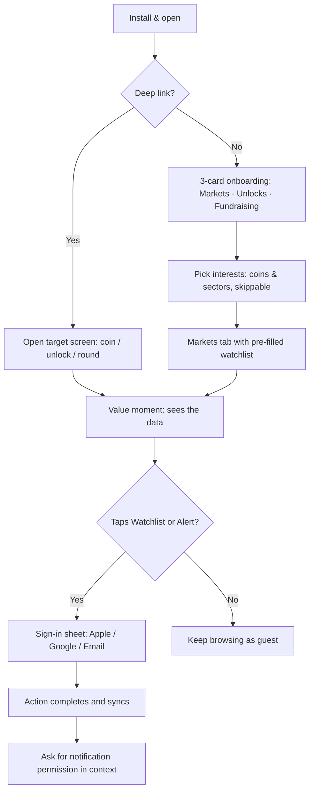
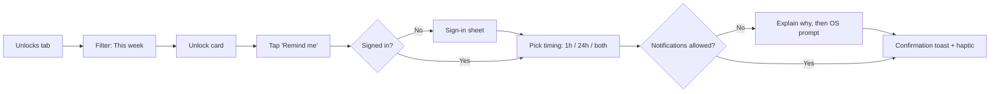
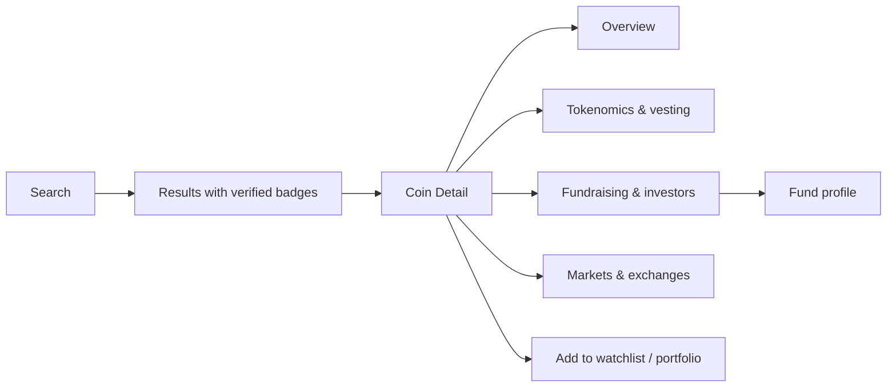

# CryptoRank Mobile App: User Journeys

> **Scope:** end-to-end journeys for the main personas of the CryptoRank (cryptorank.io) mobile app. Each journey maps the stages, user actions, touchpoints, thoughts and feelings, pain points, and design opportunities.
> **Status:** proposed draft for product and design discussion.

---

## 1. Personas

| Persona                           | Profile                                                  | Goals                                                                        | Frustrations                                               |
| ----------------------------------- | ---------------------------------------------------------- | ------------------------------------------------------------------------------ | ------------------------------------------------------------ |
| **Maya, the Active Trader**       | 29, trades daily on CEXs, checks markets 20+ times a day | Spot movers early, track the watchlist, react to unlocks before price impact | Slow apps, noisy alerts, having to switch between 4 tools  |
| **Daniel, the Research Investor** | 38, long-term holder, deep-dives before buying           | Understand tokenomics, vesting, and who funded a project                     | Scattered data, no single view of a project's fundamentals |
| **Priya, the VC / Fund Analyst**  | 33, works at a crypto fund                               | Monitor funding rounds, competitor deals, and sector trends                  | Manual spreadsheets, late news on new rounds               |
| **Leo, the Newcomer**             | 22, owns a little BTC and ETH, learning                  | Understand what the numbers mean, follow a few coins safely                  | Jargon, information overload, fear of scams                |

---

## 2. Journey Map: Maya, the Active Trader

**Scenario:** Maya wants to know which coins have large token unlocks this week so she can avoid or short them.

| Stage             | Discover                                                  | Onboard                                                                | Explore                                                             | Act                                                                 | Return                                                                                       |
| ------------------- | ----------------------------------------------------------- | ------------------------------------------------------------------------ | --------------------------------------------------------------------- | --------------------------------------------------------------------- | ---------------------------------------------------------------------------------------------- |
| **Actions**       | Sees a CryptoRank unlock chart shared on X; taps the link | Installs the app, skips the tour, signs in with Google                 | Opens the**Unlocks** tab, filters "This week", sorts by % of supply | Adds 3 tokens to her watchlist, sets a "1 hour before unlock" alert | Gets a push notification, opens the coin page, checks the price chart with the unlock marker |
| **Touchpoints**   | Social post, App Store page                               | Sign-in sheet, permissions prompt                                      | Unlock calendar, filter sheet                                       | Swipe actions, alert sheet                                          | Push notification, Coin Detail                                                               |
| **Thinking**      | "Is this data reliable?"                                  | "Don't make me fill out a long form."                                  | "Which of these actually matter?"                                   | "I need this to be fast."                                           | "Good, it reminded me in time."                                                              |
| **Feeling**       | 😐 Curious                                                | 🙂 Neutral to positive                                                 | 😀 Engaged                                                          | 😀 In control                                                       | 😄 Trusts the app                                                                            |
| **Pain points**   | The deep link opened the website, not the app             | Asked for notifications before she saw any value                       | Small unlocks clutter the list                                      | Alert setup took 4 taps                                             | The notification lacked the $ value                                                          |
| **Opportunities** | Universal links straight to the matching screen           | Ask for notification permission at the moment she sets her first alert | Default sort by "% of circulating supply" and a "> 1% only" toggle  | One-tap "Remind me" on every unlock card                            | Rich notification with amount, $ value, % of supply, and a mini chart                        |

---

## 3. Journey Map: Daniel, the Research Investor

**Scenario:** Daniel heard about a new Layer 2 project and wants to research it before buying.

| Stage             | Search                                                            | Evaluate                                                             | Compare                                                                      | Decide                                              | Monitor                                                 |
| ------------------- | ------------------------------------------------------------------- | ---------------------------------------------------------------------- | ------------------------------------------------------------------------------ | ----------------------------------------------------- | --------------------------------------------------------- |
| **Actions**       | Taps search, types the project name                               | Reads Coin Detail: price, market cap, FDV, tokenomics, vesting chart | Opens Fundraising: rounds, valuation, investors. Compares with 2 similar L2s | Adds to portfolio with buy price and amount         | Checks weekly ROI and upcoming unlocks                  |
| **Touchpoints**   | Global search, recent searches                                    | Coin Detail tabs (Overview / Tokenomics / Funding / Markets)         | Funding tab, investor profile, compare view                                  | Add-transaction sheet                               | Portfolio tab, weekly digest                            |
| **Thinking**      | "Is this the right token? There are copycats."                    | "How much supply is still locked?"                                   | "Did good funds back this, and at what price?"                               | "What's my entry vs. the private round price?"      | "Is this still a good bet?"                             |
| **Feeling**       | 😟 Wary                                                           | 🤔 Analytical                                                        | 😀 Confident                                                                 | 🙂 Committed                                        | 😐 to 😀 Depends on the market                          |
| **Pain points**   | Copycat tokens with the same ticker                               | Vesting info is buried                                               | Can't compare side by side on a phone                                        | Manual entry is tedious                             | No context for why the price moved                      |
| **Opportunities** | Verified badge, contract address, and market cap shown in results | "Supply at a glance" bar: circulating / locked / unlocked            | Swipeable compare cards (up to 3)                                            | Show "Your entry vs. seed / private / public price" | Link price moves to events (unlocks, listings, funding) |

---

## 4. Journey Map: Priya, the VC / Fund Analyst

**Scenario:** Priya does a Monday-morning scan of last week's funding rounds in her fund's focus sectors.

| Stage             | Open                                                        | Filter                                                     | Analyze                                                                | Share                                           | Follow up                                         |
| ------------------- | ------------------------------------------------------------- | ------------------------------------------------------------ | ------------------------------------------------------------------------ | ------------------------------------------------- | --------------------------------------------------- |
| **Actions**       | Opens the app from the "Weekly funding digest" notification | Fundraising → filter: AI + DeFi, last 7 days, ≥ $5M      | Opens rounds, checks lead investors, opens a competitor fund's profile | Shares a round card image to her team's Slack   | Follows 2 funds to get alerts on their new deals  |
| **Touchpoints**   | Push / email digest                                         | Filter sheet, saved filters                                | Round detail, Fund profile, portfolio list                             | Share sheet, generated image                    | Follow button, notification settings              |
| **Thinking**      | "What happened while I was away?"                           | "I set these same filters every week."                     | "Who is co-investing with whom?"                                       | "I need this in our channel now."               | "Tell me the next time they invest."              |
| **Feeling**       | 🙂                                                          | 😤 Mild annoyance → 😀 once saved                         | 😀                                                                     | 🙂                                              | 😄                                                |
| **Pain points**   | The digest isn't personalized                               | Filters reset every session                                | Hard to see co-investor patterns on a small screen                     | Screenshots look messy                          | Too many alerts if she follows big funds          |
| **Opportunities** | Digest based on followed sectors and funds                  | **Saved filters** pinned to the top of the Fundraising tab | "Frequent co-investors" section on fund profiles                       | Branded, clean share cards with source and date | Alert frequency control: instant / daily / weekly |

---

## 5. Journey Map: Leo, the Newcomer

**Scenario:** Leo installs the app to "understand crypto better" and follow BTC and ETH.

| Stage             | First open                              | Learn                                           | Personalize                                          | Habit                                           | Grow                                                                                          |
| ------------------- | ----------------------------------------- | ------------------------------------------------- | ------------------------------------------------------ | ------------------------------------------------- | ----------------------------------------------------------------------------------------------- |
| **Actions**       | Opens the app, sees the Markets list    | Taps "MCap" and "FDV" labels to understand them | Picks interests in onboarding (BTC, ETH, "Beginner") | Opens the app daily from the home-screen widget | Explores categories and reads unlock explanations                                             |
| **Touchpoints**   | Onboarding carousel, Markets            | Inline glossary tooltips                        | Interest picker, watchlist                           | Widget, daily summary                           | Category pages, learn cards                                                                   |
| **Thinking**      | "Too many numbers!"                     | "Oh, that's what FDV means."                    | "Now it's about my coins."                           | "Quick check, done."                            | "I'm starting to get this."                                                                   |
| **Feeling**       | 😰 Overwhelmed                          | 🙂 Relieved                                     | 😀                                                   | 😀                                              | 😄 Confident                                                                                  |
| **Pain points**   | Dense table on the first screen         | Jargon everywhere                               | —                                                   | Widget needs setup                              | Doesn't know what's risky                                                                     |
| **Opportunities** | "Simple view" toggle with fewer columns | Tap-to-explain ⓘ on every metric               | Pre-filled watchlist from interests                  | Prompt to add the widget after 3 sessions       | Neutral risk indicators (high unlock pressure, low liquidity) with explanations, never advice |

---

## 6. Core Flow Diagrams

### 6.1 First launch → value

### 6.2 Set an unlock alert

### 6.3 Research a project

---

## 7. Moments That Matter

| Moment                         | Why it matters                        | Success metric                               |
| -------------------------------- | --------------------------------------- | ---------------------------------------------- |
| First data screen in < 2 s     | Earns trust and reduces drop-off      | Cold start to first data ≤ 2 s (p75)        |
| First watchlist add            | Strongest early sign of retention     | % of new users adding ≥ 1 coin in session 1 |
| First alert received on time   | Proves the app's value when it counts | Alert delivery latency ≤ 30 s, open rate    |
| Shared card opened by a friend | Organic growth loop                   | Share → install conversion                  |
| Day-7 return                   | Habit formed                          | D7 retention                                 |

> **CPA build (Oct 18, 2026):** the first data screen renders the bundled figures at once and swaps in live CryptoRank prices when the REST request returns, so a slow network never delays first data.

---

## 8. Cross-Journey Pain Points & Recommendations

1. **Permission timing:** ask for notifications only when the user sets an alert, never on first launch.
2. **Saved state:** remember filters, sort orders, and chart ranges for each tab.
3. **Event context:** tie price moves to unlocks, funding, and listings on the chart.
4. **Trust signals:** data source, last-updated time, and verified contract on every key screen.
   > **CPA build (Oct 18, 2026):** live prices are labelled "CryptoRank" and sample figures "CPA sample data". The last-updated time is when CryptoRank reported the price, so a delayed sync shows as stale instead of looking fresh.
5. **Progressive disclosure:** "Simple" vs "Pro" density setting to serve both Leo and Maya.
6. **Guest mode:** let users browse fully without an account. Require sign-in only for sync, alerts, and portfolio.

==========================================================================================================================================================================================================

From Idea to blueprint: the planning pipeline
1. What is it?
  [CryptoRank.io](https://www.google.com/search?q=CryptoRank.io) is a comprehensive **cryptocurrency data, analytics, and market research platform**. It aggregates real-time and historical on-chain and off-chain data to help retail traders, institutional investors, and developers make data-driven decisions.
  While it tracks standard metrics like token prices, volume, and market cap, it is specifically used for deep-dive tracking of **tokenomics, venture capital fundraising, and early-stage crypto markets**.

3. What Problem? TheProblem is that retail traders and institutional investors often lack comprehensive, real-time insights into tokenomics, venture capital activities, and early-stage crypto markets, making it difficult to make informed investment decisions.

4. Who are the users? The user are retail traders, institutional investors, and developers interested in cryptocurrency markets.

5. Features: Reasons to log in? Create Read Update Delete Search Filter Sort Share?
Key Features & Use Cases

- **Fundraising & Venture Capital Tracking:** Users track which projects are securing capital by looking at private funding rounds (Seed, Series A, etc.). It maps out portfolios of major venture capital funds (like Coinbase Ventures or Animoca Brands), allowing investors to see where institutional money is flowing.
- **Token Unlocks & Vesting Schedules:** A standout feature used to predict market volatility. It tracks exact vesting dates and token allocations, warning traders when a massive supply of tokens will be unlocked and potentially dumped onto the market.
- **ICO / IEO / IDO Crowdfund Analytics:** Investors monitor token launchpads and upcoming public sales. It calculates historical Return on Investment (ROI) for various initial token offerings.
- **Free Multi-Chain Portfolio Tracking:** Users can connect public wallet addresses across multiple networks (such as Ethereum, Solana, and TON) to monitor their live asset allocations and PnL automatically without revealing private keys.
- **Airdrop Hunting ("Drop Hunting"):** CryptoRank catalogs highly active or emerging early-stage Web3 projects. It provides step-by-step guides on how users can participate in testnets or protocols to qualify for potential upcoming airdrops.
- **Prediction Market & RWA Aggregation:** The platform normalizes and compares data across prediction venues like Polymarket and Kalshi. It also features dedicated dashboards tracking tokenized Real-World Assets (RWAs) like tokenized stocks, ETFs, and commodities.
- **Developer Data API & MCP:** For developers and quantitative researchers, CryptoRank provides a high-throughput public API. It also native integrates with AI tools using a Model Context Protocol (MCP) server, allowing users to run complex crypto research using AI models directly.

6. User journey: The user journey typically begins with a user signing up or logging into the platform. They may start by exploring the dashboard to get an overview of market trends and their portfolio performance. Users can then dive into specific features such as fundraising tracking, token unlock schedules, or airdrop opportunities. Throughout their journey, users interact with various analytics tools, set up alerts for significant events, and utilize the developer API for advanced research. The journey concludes with users making informed investment decisions based on the comprehensive data and insights provided by the platform.

7. Screens: The platform features several key screens that users interact with:
- **Dashboard:** Provides an overview of market trends, portfolio performance, and key metrics.
- **Fundraising & Venture Capital Tracking:** Displays information on private funding rounds, venture capital portfolios, and investment trends.
- **Token Unlocks & Vesting Schedules:** Shows upcoming token unlock events and vesting schedules to help predict market volatility.
- **ICO / IEO / IDO Crowdfund Analytics:** Lists upcoming token sales, historical ROI, and performance metrics for initial token offerings.
- **Portfolio Tracking:** Allows users to connect public wallet addresses and monitor live asset allocations and PnL across multiple networks.
- **Airdrop Hunting:** Highlights active or emerging Web3 projects and provides guides for participating in testnets or protocols to qualify for airdrops.
- **Prediction Market & RWA Aggregation:** Displays normalized data from prediction markets and dashboards for tokenized real-world assets.
- **Developer Data API & MCP:** Provides access to the public API and integration with AI tools for advanced research and analysis.

8. When Things Break? The platform will have a dedicated support page where users can report issues or seek help. If the platform experiences downtime or technical issues, users will be notified through a banner on the dashboard and via email if they are logged in. The platform will also have a FAQ section to address common questions and concerns. In the event of a bug or error, users can submit a support ticket, and the development team will work to resolve the issue as quickly as possible. Regular maintenance and updates will be performed to ensure the platform remains stable and secure. Users will be encouraged to provide feedback on their experience, and this feedback will be used to improve the platform.

9. Context Package: Draw Figma wireframes and stories to hand to Claude Code.

   The 8-Question Practical Template
   10. What problem does the cryptocurrency app solve? The app solves the problem of
   users having to manually track multiple sources of cryptocurrency data and analytics. It provides a centralized platform where users can access comprehensive market information, track fundraising events, monitor token unlock schedules, discover airdrop opportunities, and analyze real-world asset tokenization, all in one place.

   11. Who are the users? Who are the users? Who is the target audience? The target audience for the cryptocurrency app includes individual investors, traders, and enthusiasts who are interested in tracking and analyzing the cryptocurrency market. It also caters to developers and quantitative researchers who require access to comprehensive market data and advanced analytics tools. The users are likely to be tech-savvy individuals who are comfortable using digital platforms for financial management and investment purposes. They may include both retail and institutional investors looking for insights into fundraising, token unlock schedules, airdrop opportunities, and real-world asset tokenization. Overall, the target audience is diverse but shares a common interest in leveraging data and analytics to make informed decisions in the cryptocurrency space.

   12. What are their primary goals? The primary goals of the users are to efficiently track and analyze cryptocurrency market trends, stay informed about fundraising events and token unlock schedules, discover airdrop opportunities, and gain insights into real-world asset tokenization. Users aim to make informed investment decisions, optimize their trading strategies, and leverage advanced analytics tools for research and analysis. Overall, the primary goals of the users are to have a comprehensive and centralized platform that simplifies cryptocurrency data management and enhances their ability to make data-driven decisions in the crypto space.

   13. What information do the users need? The users need information about cryptocurrency market trends, fundraising events, token unlock schedules, airdrop opportunities, and real-world asset tokenization. They also require access to historical data, analytics tools, and insights to support their investment and trading decisions. Additionally, users may need information about platform features, account settings, and any updates or announcements related to the cryptocurrency market. Overall, users need comprehensive, accurate, and timely information to make informed decisions in the crypto space.

   14. What actions can the users perform? The users can perform actions such as signing up for an account, logging in and out, browsing cryptocurrency market data, searching for specific tokens or projects, filtering data by various criteria, tracking fundraising events, monitoring token unlock schedules, participating in airdrop opportunities, analyzing real-world asset tokenization, accessing historical data and analytics tools, managing their account settings, and providing feedback or reporting issues. Overall, the users have a range of actions they can perform to effectively manage their cryptocurrency investments and research activities.

   15. What pages are required for the CryptoRank App Users? The required pages for the CryptoRank App users include:
    -Homepage: Featuring an overview of the cryptocurrency market, trending tokens, recent fundraising events, upcoming token unlocks, and personalized recommendations.
    -Token/Project Detail Page: Providing detailed information about each token or project, including market data, fundraising history, token unlock schedules, airdrop opportunities, and related analytics.
    -Search Results Page: Displaying search results based on user guided query and allowing users to filter results by market cap, trading volume, or popularity.
    -Watch list Page: Allowing users to view and manage their saved tokens or projects for later tracking.
    -Favorites Page: Allowing users to view and manage their favorite tokens or projects.
    -Account Settings Page: Allowing users to manage their profile information, subscription plans, billing plans (such  as change billing date, cancel, subscription and pause subscription) payment options, and preferences, including autoplay previews and autoplay next episode (which actually start or stop video), an accessibility section, and a red Delete Account button in a danger zone. Deleting asks the user to: cancel their subscription first (delete won't work until it is cancelled, and it only removes their access to the app); type their email address and enter their password to confirm; and contact support to submit a ticket if they also want their data removed.
    -Customer Support Page: Providing users with options to report issues, seek help, and access FAQs.
    -Login/Signup Page: Allowing users to create an account or log in to their existing account, or try a private demo account. New passwords need at least 13 characters with a lowercase letter, an uppercase letter, a digit and a symbol, and passwords known from data leaks are refused.
    -Forgot Password / Reset Password Pages: Allowing users who forgot their password to request a reset link by email, then choose a new password from that link (expired links ask for a new one).
    -Logout Page: Allowing users to log out of their account securely.
    -Legal and Privacy Pages: Providing users with information about the website's terms of service, privacy policy, and any legal disclaimers related to content.
    -Error/Issue Reporting Page: Allowing users to report bugs, errors, or technical issues they encounter while using the platform.
    -Feedback Page: Allowing users to provide feedback on their app experience and suggest improvements for the platform.
    -Promotions/Discounts Page: Providing users with information about any ongoing promotions or discounts available for subscription plans or content access.
    -Technical Requirements Page: Providing users with information about the technical requirements for using the CryptoRank App, including supported devices, internet speed recommendations, and any other necessary specifications to ensure optimal performance.

    -FAQs Page: The FAQs (Frequently Asked Questions) segments are designed to help users navigate the platform’s comprehensive cryptocurrency data, analytical tools, and reward ecosystems.Rather than having one single, massive FAQ page, CryptoRank typically distributes its specialized FAQ blocks across specific feature pages to directly guide users through its different services:
    • Platform Gamification & Free Rewards (/earn FAQ): Explains how to use the site's ecosystem features, such as earning and spending CryptoRank Spaceships (internal loyalty currency), understanding community quests, participating in promotional raffles, and tracking claimed rewards.
    • Fundraising & Venture Capital Tracking (/funds FAQ): Helps users research venture capital portfolios and blockchain investment trends. It answers common queries about how crypto funds are tiered, how to track who a fund follows on social media, what investor types are covered, and how to analyze their investment sectors.
    • API Documentation & Subscription Plans: Provides technical guidance for developers and institutional users looking to integrate CryptoRank’s market data API, detailing credit limits, endpoints, pricing plan distinctions, and data history depths

    -Terms of Service Page: Outlining the rules and guidelines for using the platform, including user responsibilities and limitations of liability.
    -Privacy Policy Page: Detailing how user data is collected, stored, and used by the platform, including information about cookies, data sharing, and user content.
    -AI Integration Page: Providing users with information about any AI-powered features or recommendations available on the platform, including how AI is used to enhance the user experience and improve content discovery.
   -Accessibility Policy Page: Linked in the footer of every page. Explains the platform's commitment and the WCAG 2.2 AA standard it follows, lists the accessibility features (the accessibility menu, closed captions, keyboard-accessible player controls, autoplay control), video player keyboard shortcuts, known limitations, and how to report an accessibility issue.
   -Accessibility Menu (on every page): A menu like the OneTap accessibility app, opened from an icon in the page header, with one-tap profiles and settings for text size, fonts, line height, letter spacing, text alignment, contrast, saturation, highlighted links and headings, strong focus outline, big cursor, reading guide, hiding images, stopping animations, closed captions and caption size, and autoplay.
   -Affiliate Program Page: Providing information about my affiliate program, including how users can participate, earn commissions from referrals, and access marketing materials to promote the streaming service. This page will outline the terms and conditions of the affiliate program, including eligibility requirements, commission structure, payment methods, and any restrictions or limitations on promotional activities. Users will also find resources and support for optimizing their affiliate marketing efforts, such as tips for driving traffic, tracking referrals, and maximizing earnings. The Affiliate Program Page will serve as a comprehensive guide for users interested in becoming affiliates and promoting the streaming platform to their audience, helping to expand the reach of the service and attract new subscribers through word-of-mouth marketing and online promotion.

16.  What data must be collected? The data that must be collected includes user account information (such as name, email address, and password), subscription plan details, payment information (such as credit card or billing details), viewing history and preferences for personalized recommendations, user ratings and reviews for cryptocurrency content, watch lists and favorite content, search queries and filter settings, device information (such as device type and operating system), technical requirements for cryptocurrency content (such as internet speed and supported devices), feedback and suggestions from users, bug reports and error logs, promotional and discount usage data, and any other relevant data necessary for the functionality and improvement of the cryptocurrency platform. Additionally, data related to user interactions with the website, such as click-through rates, time spent on pages, and engagement with content, may also be collected to enhance the user experience and optimize content recommendations. All data collection will be conducted in compliance with privacy regulations and best practices to ensure the security and confidentiality of user information. This data will be used to improve the platform's features, provide personalized experiences, and support the overall growth and development of the cryptocurrency ecosystem.

17. What permissions exist? The permissions that exist include user consent for data collection and usage, access to user account information permission granted by the user, permission to send notifications and updates related to the cryptocurrency service, permission to access device information for technical requirements and compatibility, permission to collect and analyze viewing history and preferences for personalized recommendations, permission to access and manage watch lists and favorite content, permission to collect feedback and suggestions from users, permission to access user ratings and reviews for cryptocurrencies, permission to access search queries and filter settings, permission to collect promotional and discount usage data. Permission to access and analyze user interactions with the website, such as (click-through rates, time spent on pages, and engagement with content for optimization purposes), and permission to comply with legal and regulatory requirements related to data privacy and security. Users will have the ability to manage their permissions and preferences through their account settings, including opting out of certain data collection practices and adjusting notification preferences. The cryptocurrency platform will ensure that all permissions are clearly communicated to users and that their privacy is respected at all times.

